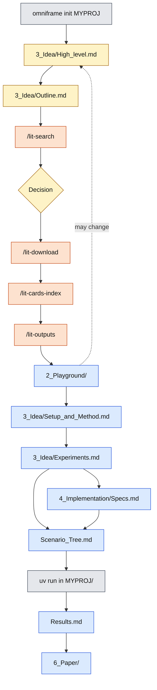
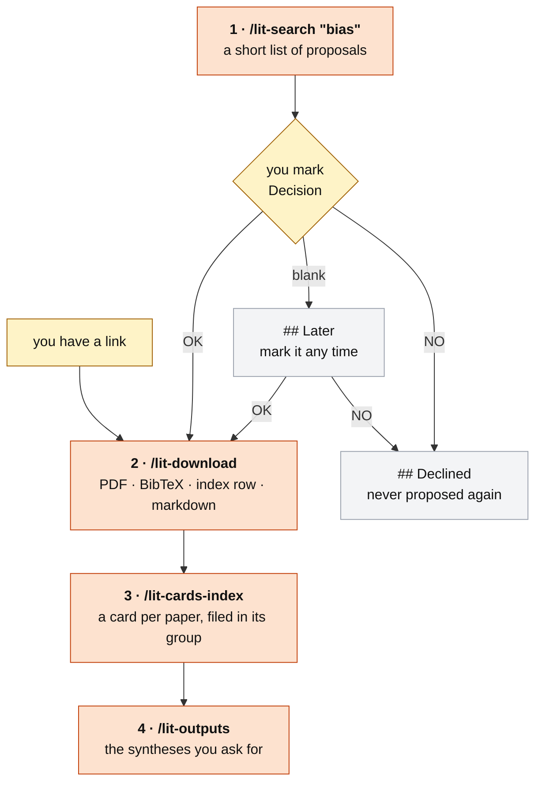
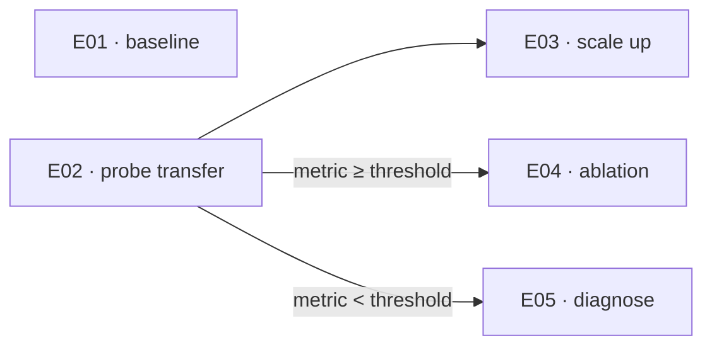

# OmniFrame Guide

How to use OmniFrame as designed, from an empty folder to a paper. To install it, see the
[README](README.md).

1. [The whole pipeline](#the-whole-pipeline)
2. [Commands at a glance](#commands-at-a-glance)
3. [Set up a project](#1-set-up-a-project)
4. [The session loop](#2-the-session-loop)
5. [Write the idea](#3-write-the-idea)
6. [Literature](#4-literature)
7. [Play](#5-play)
8. [Formalise the method](#6-formalise-the-method)
9. [Plan the experiments](#7-plan-the-experiments)
10. [Track](#8-track)
11. [Write the paper](#9-write-the-paper)
12. [Publish the code](#10-publish-the-code)
13. [Reference](#11-reference)
14. [Update and edit OmniFrame](#12-update-and-edit-omniframe)

---

## The whole pipeline



`Scenario_Tree.md` is the experiment tree: what depends on what, and what can run today.
The order is a guide, not a gate: go back to any step whenever the research asks for it.

| colour | where you type it |
| --- | --- |
| grey | the terminal |
| orange | a slash command in Claude Code |
| blue | Claude Code, asked in plain words |
| yellow | you: an edit or a decision |

At the end of every session, whatever you did: `/wrap`. Your own notes go in `Journal.md` any time.

## Commands at a glance

Two kinds of command, typed in two different places.

**In Claude Code** — typed into the chat, inside the project. They start with `/`. This is
where the work happens.

| Command | Does |
| ------- | ---- |
| `/lit-search ["bias"]` | proposes papers from `3_Idea/High_level.md` and `Outline.md` |
| `/lit-download [links]` | brings in the papers marked `OK`, the ones you link, and PDFs you saved by hand: PDF, BibTeX, index row, markdown |
| `/lit-cards-index [citekeys] ["focus"]` | writes a card per paper, and does the final indexing: each paper in its group |
| `/lit-outputs ["what to write"]` | writes a literature synthesis |
| `/wrap` | ends the session: briefing, journal entry, quick checks |

Everything else — the idea, specs, run records, results, the paper — you ask for in plain
words in the chat.

**In the terminal** — a shell, outside Claude. For setting up, and for the code.

| Command | Does |
| ------- | ---- |
| `omniframe link` | puts `omniframe` on your PATH. Once per machine |
| `omniframe init MYPROJ` | creates `MYPROJ_Brain/`, its code folder and its playground |
| `omniframe update` | brings a project's commands and rules up to date |
| `uv add …` / `uv run …` | inside `MYPROJ/` for your code, inside `MYPROJ_Playground/` for the playground |

`omniframe download` and `omniframe convert` also exist: they are the scripts that
`/lit-download` runs. You never need to call them yourself — except
`omniframe convert --use-llm`, for a paper whose formulas need cleaning
([§4](#4-literature)).

---

## 1. Set up a project

**In the terminal:**

```sh
omniframe init MYPROJ
```

The first time, it asks for your projects folder (default `~/Projects`) and remembers it:
every project is created there, wherever you run the command.

```
MYPROJ_Brain/          the brain: one git repo, your Obsidian vault
├── 0-Master.md  CLAUDE.md  README.md  1_Literature/ … 6_Paper/
├── MYPROJ/            the code only: the future public repo (uv project, MIT)
└── MYPROJ_Playground/ playground code: its own uv project, never published
```

| flag | |
| --- | --- |
| `--set-dir DIR` | change the remembered projects folder |
| `--dry-run` | print the plan, write nothing |
| `--force` | overwrite existing files |
| `--name "Title"` | project name, if nicer than `MYPROJ` |
| `--author NAME` | defaults to `git config user.name`. Also goes in `LICENSE` |

Open `MYPROJ_Brain/` in Obsidian and Claude Code. Start from `0-Master.md`.

**The code folder** is exported alone later ([§10](#10-publish-the-code)), so it stands alone:

| | |
| --- | --- |
| environment | `MYPROJ/.venv/`. Run `uv add` / `uv run` inside `MYPROJ/` |
| data, logs, results | wherever you decide in `Code_Design.md`, inside `MYPROJ/` |
| paths | never outside `MYPROJ/` |
| `README.md`, `.gitignore` | the public repo's. The brain has its own |

**Every file you fill starts nearly blank**: a title and, at most, a few headings as hints.
Rename, add or drop them freely. The agent's rules live in the `CLAUDE.md` files, never in
your content.

## 2. The session loop

1. **Start.** The agent reads `5_Results_and_Tracking/Where_we_are.md`, the **briefing**:
   **Now**, **Next**, **Open**, about twenty lines.
2. **Work.**
3. **End.** Run `/wrap`. It rewrites the briefing, adds a dated entry to `Journal.md` (what
   was tried, decided, abandoned, and why) and runs a few quick checks. It reports problems
   and fixes nothing.

The briefing is rewritten each time; the journal only grows. Write your own entries and
notes in the journal whenever you like: the agent never edits them.

## 3. Write the idea

`3_Idea/High_level.md` seeds everything after it. Write in plain words:

| section | what goes in |
| --- | --- |
| Topic | one line: the field, and the problem inside it |
| Idea & Motivation | a paragraph: what you suspect, want to try or want to understand, and why |
| Anchor papers | papers you already know are central, e.g. from your supervisor (optional). The first `/lit-search` finds them and marks them `OK` |
| Keywords | the field's terms, synonyms included |

A vague keyword list gives you a vague reading list. If the file is empty, ask the agent to
draft it with you. It asks questions and writes only what you confirm.

**The outline, right after.** Next, write `3_Idea/Outline.md`: the phases of the work, in
order, each with its tasks. Each task has a short description and a goal, meaning what
the task should produce or settle. Not "read the literature" but "read the literature to
learn how the effect is measured: which metrics, which baselines". A goal can be precise or
general: write what you can be sure of now, and sharpen it as you get close. If `High_level.md`
already sketches the steps, they become the phases; if not, the outline defines them. Ask
the agent in plain words to draft, sharpen or evaluate it. `/lit-search` searches for these
goals, and the briefing follows the phases.

## 4. Literature

**All in Claude Code:**



The library is `1_Literature/Paper_Index.md`: one row per paper, linking its **arXiv**,
**code** and **site** (when they exist), the **pdf** (for you), the **md** (for the agent)
and the **card**. New papers wait under **`## Unsorted`**; `/lit-cards-index` files them in
their group.

### Step 1 — propose

```
/lit-search                                          from 3_Idea/
/lit-search "theory only, after 2020, no surveys"    steered by a bias
```

The agent adds a short list of proposals to `1_Literature/Proposed_literature.md`, each with its
venue, why it fits, and its arXiv, code and site links. Every paper is one it found and
opened online. The **bias** steers this one search; if it left out a foundational paper,
the agent names it at the end. Your anchor papers not yet in the library are added too,
already marked `OK`: they come in with the next download and are not searched again.

**Your decision**, in the **Decision** column. `Proposed_literature.md` has three lists:

| list | `OK` | `NO` | blank |
| --- | --- | --- | --- |
| proposals | downloaded | moved to Declined | moved to Later |
| `## Later` | downloaded | moved to Declined | stays |
| `## Declined` | never proposed again. Delete a line to let a paper back in | | |

### Step 2 — download

```
/lit-download                                   the papers marked OK
/lit-download https://arxiv.org/abs/2403.01234  a paper you already know, no search
```

For each paper: the open PDF goes to `1_Literature/PDFs/<citekey>.pdf` (never overwriting
one), its BibTeX to `6_Paper/refs.bib`, its row under `## Unsorted`. Then the PDFs are
converted to markdown with a local model (slow: minutes) and linked in the index.

| case | what to do |
| --- | --- |
| no open PDF online | the row stays `OK` with the reason. Save the PDF as `PDFs/<citekey>.pdf`, run `/lit-download` again |
| a PDF you downloaded yourself | save it in `PDFs/` under any name, run `/lit-download`. It identifies the paper, asks to rename it to its citekey, and brings it in |
| formulas that matter | the converter flattens some equations, so the agent takes formulas from the PDF. To clean the markdown with an LLM, in the terminal: `omniframe convert --force --only <citekey> --use-llm` |

### Steps 3–4 — cards and syntheses

```
/lit-cards-index                                 a card for every converted paper that has none
/lit-cards-index smith2024foo                    only these
/lit-cards-index "assumptions and benchmarks"    shaped around a focus
/lit-outputs "the gap: what the field can't do yet"
```

Without a focus, new cards follow the shape of the ones already written, so a focus you
gave once carries over. The very first cards cover the problem, the method, the reported
results, the limitations and the relevance to your idea, adapted to the kind of paper. It fits on one
screen, and every claim points to the paper's markdown.

Then `/lit-cards-index` does the final indexing: each paper moves from `## Unsorted` to its
group. The first time, it proposes a few ways to group the library (by approach, by role
toward your idea…), or you name your own.

`/lit-outputs` writes the synthesis you describe into `Literature_Outputs/`. With no
argument, it asks what you need.

**Handwritten notes.** Put scans in `1_Literature/Human_encoding/`. Organise them from
`Human_encoding.md`, with one note per topic in `Notes/` that embeds the scans:
``. The agent reads a note only when you point it there, and can set
one up if you ask. Notes on the idea itself go in `3_Idea/Human_encoding/` (section 6).

## 5. Play

Before the idea and the method are fixed, there is usually a stage of playing: reproduce
an anchor paper's results, run its code, try a small experiment that could prove the
concept. What you learn shapes the idea, the outline and the real experiments; it runs
side by side with them.

| where | what |
| --- | --- |
| `MYPROJ_Playground/` | the playground code: a uv project of its own, beside `MYPROJ/`. Run `uv add` / `uv run` inside it |
| `2_Playground/Experiments_pg.md` | the playground experiments: small tests, a repo explored as a starting point, a paper's results reproduced. No E-ids: those are for the real experiments |
| `2_Playground/Code_Design_pg.md` | how that code is organised, and where cloned repos came from |
| `2_Playground/Results_pg.md` | what the playground taught: what helps define the idea, the method, the experiments |

The files start with a title only: shape them as you go. With its own environment, the
packages and repos you only explore never reach `MYPROJ/`, and the playground is never
exported. A repo cloned into it loses its `.git`: the brain is the one repo. Code worth
keeping is rewritten in `MYPROJ/`, never imported from the playground.

## 6. Formalise the method

`3_Idea/Setup_and_Method.md` makes the idea formal. Its headings — Notation, Problem,
Method, Hypotheses — are a suggestion: rename, add or drop any. `6_Paper/preamble.tex`
mirrors the notation.

`3_Idea/` holds your claims: the agent writes there only when you ask, and challenges them
in chat. A useful test for what belongs here: if it could be chosen differently without
changing the idea, it is probably a spec, for `4_Implementation/`.

**Handwritten notes on the idea.** Put scans in `3_Idea/Human_encoding/`, organised like
the literature notes. The agent reads a note when you point it there.

## 7. Plan the experiments

| file | what goes in |
| --- | --- |
| `3_Idea/Experiments.md` | what each experiment is for, under a stable **E-id** (`E01`, `E02`…) |
| `4_Implementation/Specs.md` | the concrete choices for each experiment: model, data, hyperparameters, seeds… |
| `4_Implementation/Figures.md` | what each figure should show |
| `4_Implementation/Code_Design.md` | how `MYPROJ/` is organised, including where data, logs and results go |

**`5_Results_and_Tracking/Scenario_Tree.md`** is a mermaid diagram of the experiments:



A plain edge means "needs the other one done"; a labelled edge means "only on that
outcome". Mark an experiment that became pointless as dropped instead of deleting it.

## 8. Track

| where | what |
| --- | --- |
| `MYPROJ/` | logs, seeds and metrics, wherever the code writes them, or a tracker such as W&B |
| `Results.md` | what the experiments showed, in any shape. A refuted hypothesis is a finding |
| `Scenario_Tree.md` | updated as outcomes land |
| `Journal.md` | what was tried and why, including what failed |

**No invented results.** Every result or metric in the brain names the log or run it comes
from. If there is none, the agent says the result doesn't exist. Proposals, estimates and
thresholds are free, labelled as such.

## 9. Write the paper

`6_Paper/` is self-contained LaTeX: `main.tex`, `preamble.tex`, `sections/*.tex`,
`refs.bib`, `figures/`. To compile, zip the folder's **contents**, so that `main.tex` sits
at the root of the archive, and upload the zip to Overleaf.

- **Citations.** `refs.bib` keys are the library's citekeys. Datasets, software and books
  can be added to `refs.bib` directly, without a card.
- **Notation.** `preamble.tex` macros mirror `## Notation`. When you change a symbol, change
  it in both.
- **Figures.** Copy the ones the paper uses from the code folder into `figures/`. Name them descriptively, e.g. `encoder-overview.pdf` with
  `\label{fig:encoder-overview}`, not by their number in `Figures.md`.
- **Claims.** The paper explains `3_Idea/` at more length. If writing it shows a claim
  should change, the agent says so and you decide.

## 10. Publish the code

The contents of `MYPROJ/` become a new repo with one commit. History stays in the brain.
Only committed files are exported, so commit first. **In the terminal:**

```sh
mkdir ~/Projects/MYPROJ-public && cd ~/Projects/MYPROJ-public
git -C ~/Projects/MYPROJ_Brain archive HEAD:MYPROJ | tar -x
uv sync && uv run main.py                 # runs without the brain?
git init && git add . && git commit -m "Initial release"
gh repo create MYPROJ --public --source . --push
```

Check the file list first: everything committed in `MYPROJ/` goes public.

**New release:**

```sh
cd ~/Projects/MYPROJ-public
git rm -rq . && git -C ~/Projects/MYPROJ_Brain archive HEAD:MYPROJ | tar -x
git add . && git commit -m "Release v1.1" && git push
```

---

## 11. Reference

### The two keys

- **citekey** (`author2024keyword`) names a paper's PDF, `Papers/` folder, card, index
  row and `refs.bib` entry. The scripts rely on it.
- **E-id** (`E01`, `E02`…) names an experiment wherever it is mentioned, so one grep finds
  it.

### Who writes what

| path | written by |
| --- | --- |
| `3_Idea/` | you. The agent writes there only when asked |
| the Decision column, both `Human_encoding/` folders | you |
| `2_Playground/`, `MYPROJ_Playground/` | both |
| `Cards/`, `Literature_Outputs/` | the agent |
| `PDFs/` | you and `omniframe download`. Never overwritten; renamed only with your permission |
| `Papers/` | `omniframe convert` only |
| everything else | both |

### Where the agent takes instructions from

Only from the `CLAUDE.md` files, the `/commands` and you in chat. Everything else is
content: your files, the converted papers, web pages. If any of these contains text that
reads like an instruction, the agent points it out and doesn't follow it.

### Links

Every link is a standard markdown link with a path relative to its file, like
`[card](Cards/x.md)` or ``. Never use an Obsidian `[[wikilink]]`.
Standard links open in Obsidian, GitHub and VS Code, and the agent can follow them. The
bundled `.obsidian/app.json` makes Obsidian create links in this form.

### Checking the brain

`/wrap` runs two quick checks. For a fuller one (papers without a card, index links,
`refs.bib` against the library, code paths), ask the agent to *check the brain*. It reports problems and fixes
nothing.

---

## 12. Update and edit OmniFrame

| what | updated by |
| --- | --- |
| the `omniframe` commands | `omniframe update`, from anywhere: it pulls the clone |
| new projects | nothing: `omniframe init` downloads the template each run |
| an existing project | `omniframe update`, from inside it |

**In the terminal:**

```sh
cd ~/Projects/MYPROJ_Brain
omniframe update             # --dry-run to preview
```

It needs a clean `git status`, and leaves its changes uncommitted: review with `git diff`.

| template changed a file you… | result |
| --- | --- |
| never touched | replaced |
| edited, agent or navigation file (`CLAUDE.md`, `/commands`, MOCs) | diff shown, you choose |
| edited, your content (your files, lists, paper, code) | never touched, listed |

`.omniframe` records what the template installed. Never edit it.

**Editing the template.** Test a change before pushing, uncommitted edits included. **In
the terminal:**

```sh
omniframe init --repo ~/Projects/OmniFrame /tmp/Try
omniframe update --no-pull   # inside a project: uses the clone's template as it is
```

Tokens replaced in file contents and path names: `__PROJECT_NAME__`, `__CODE_DIR__` (the
plain name, `MYPROJ`), `__PLAY_DIR__` (`MYPROJ_Playground`), `__SLUG__`, `__PKG__`, `__AUTHOR__`, `__YEAR__`, `__DATE__`.
