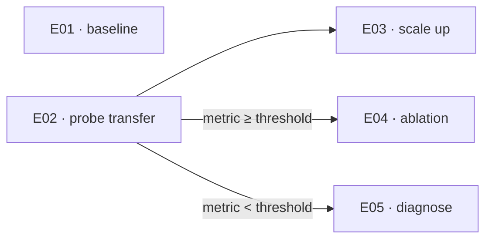

# OmniFrame Guide

How to use OmniFrame as designed, from an empty folder to a paper. To install it, see the
[README](README.md).

Commands starting with `/` run in Claude Code. The others run in the terminal, from
anywhere inside the project.

1. [Set up a project](#1-set-up-a-project)
2. [The session loop](#2-the-session-loop)
3. [Write the idea](#3-write-the-idea)
4. [Find papers](#4-find-papers)
5. [Download and convert](#5-download-and-convert)
6. [Cards and syntheses](#6-cards-and-syntheses)
7. [Formalise the method](#7-formalise-the-method)
8. [Plan the experiments](#8-plan-the-experiments)
9. [Run and track](#9-run-and-track)
10. [Write the paper](#10-write-the-paper)
11. [Publish the code](#11-publish-the-code)
12. [Reference](#12-reference)
13. [Update and edit OmniFrame](#13-update-and-edit-omniframe)

---

## 1. Set up a project

```sh
cd ~/Projects
omniframe init MYPROJ
```

```
MYPROJ_Brain/          the brain: one git repo, your Obsidian vault
├── 0-Master.md  CLAUDE.md  README.md  1_Literature/ … 5_Paper/
└── MYPROJ/            the code only: the future public repo (uv project, MIT)
```

| flag | |
| --- | --- |
| `--dry-run` | print the plan, write nothing |
| `--force` | overwrite existing files |
| `--name "Title"` | project name, if nicer than `MYPROJ` |
| `--author NAME` | defaults to `git config user.name`. Also goes in `LICENSE` |

Open `MYPROJ_Brain/` in Obsidian and Claude Code. Start from `0-Master.md`.

**The code folder** is exported alone later ([§11](#11-publish-the-code)), so it stands alone:

| | |
| --- | --- |
| environment | `MYPROJ/.venv/`. Run `uv add` / `uv run` inside `MYPROJ/` |
| artifacts | `data/`, `outputs/` inside it, gitignored |
| paths | never outside `MYPROJ/` |
| `README.md`, `.gitignore` | the public repo's. The brain has its own |

**Every file you fill starts as a blank form**: headings, table headers and field labels,
with no instructions inside. This guide says what goes under each heading. The agent's
rules live in the `CLAUDE.md` files, never in your content.

## 2. The session loop

1. **Start.** The agent reads `4_Results_and_Tracking/Where_we_are.md`, the **briefing**:
   **Now**, **Next**, **Open**, under twenty lines.
2. **Work.**
3. **End.** Run `/wrap`. It rewrites the briefing and runs a quick consistency check. It
   reports problems and fixes nothing.

The briefing is rewritten each time, never appended to. Git keeps the history.

**Status.** Every file someone writes (the idea, specs, results, cards…) has a `status`:

| status | means | set by |
| --- | --- | --- |
| `empty` | the form is untouched | the template |
| `filled` | it has content | whoever writes in it first |

`grep -rn "status: empty"` lists what is left to write. If you fill a file by hand, change
its label yourself, or `/wrap` will spot it and ask. Lists kept by scripts (the paper
index, the proposals), run records and navigation pages have no status.

## 3. Write the idea

`2_Idea/High_level.md` seeds everything after it. Write in plain words:

| section | what goes in |
| --- | --- |
| Topic | one line: the field, and the problem inside it |
| The idea | a paragraph: what you suspect, want to try or want to understand |
| In scope, out of scope | what the reading should cover, and what looks close but isn't |
| Anchor papers | papers you already know are central (optional) |
| Keywords | the field's terms, synonyms included |

A vague keyword list gives you a vague reading list. If the file is empty, ask the agent to
draft it with you. It asks questions and writes only what you confirm.

## 4. Find papers

```
/lit-search                                          # from High_level.md alone
/lit-search "theory only, after 2020, no surveys"    # steered by a bias
```

The agent adds about ten proposals to `1_Literature/Proposed_literature.md`, each with its
venue, why it fits and its links. Each paper is one the agent found and opened online, never
one recalled from memory.

| Link | holds |
| ---- | ----- |
| **arXiv** | the arXiv page, or the paper's own page if it is not on arXiv. Always there |
| **Code** | the official GitHub repo. Blank if none |
| **Site** | the official project page. Blank if none |

The optional **bias** steers this one search. It narrows `High_level.md` and is not saved.
If it would exclude a foundational paper (for example, "after 2020" would drop the 2017
paper the field rests on), the agent names that paper and asks you before searching.

**Choose** by filling the **Decision** column. Only you write in it; a legend above the
table repeats the marks.

| Decision | at download |
| ---- | ----------- |
| `OK` | downloaded into the library |
| `LATER` | moved to `## Later`, kept across searches. Mark it `OK` there at any time |
| `NO` | moved to `## Declined`, never proposed again. Delete its line to let it back in |
| blank | dropped. A later search may propose it again |

## 5. Download and convert

```
/lit-download                  # fetch the OK papers, then reset the table
```

`/lit-download` runs the terminal script `omniframe download` and reports what arrived.
The script works on its own too:

```sh
omniframe download --dry-run    # preview
omniframe download              # same as /lit-download
omniframe download --list       # every proposal and its mark
```

For each `OK` paper, the download:

- finds the open PDF from the arXiv link (arXiv, OpenReview, or Semantic Scholar by DOI)
  and saves it as `1_Literature/PDFs/<citekey>.pdf`, never overwriting an existing one
- adds its BibTeX to `5_Paper/refs.bib`, taken from the DOI or arXiv
- adds a row to `1_Literature/Paper_Index.md`, with the paper's links

If no open PDF is found, the paper stays `OK` with the reason in its row. Save the
PDF yourself under that name and run the command again.

```sh
omniframe convert               # every PDF without markdown yet
omniframe convert --list        # state of the library
```

This writes `1_Literature/Papers/<citekey>/`, the markdown plus extracted images. Papers
already converted are skipped, so running it again is safe. Other flags: `--only <citekey>`,
`--force`, `--dry-run`. In Claude Code, `/lit-convert` does the same and links each result
in the index.

**Already have a PDF?** Save it as `1_Literature/PDFs/<citekey>.pdf` (citekey format:
`author2024keyword`) and convert it. No search needed.

**Formulas.** The converter outputs some equations as clean LaTeX and flattens others into
HTML. This is by design: the agent uses the markdown to understand a paper and never
copies a formula from it. When it needs a formula, it asks you, and the PDF is the
authority. For a paper whose maths matters, an external LLM can clean it up. This costs
money, unless you use a local Ollama:

```sh
omniframe convert --force --only <citekey> --use-llm
```

## 6. Cards and syntheses

`1_Literature/card&outputs_def.md` is your **brief** to the agent, the one content file
that gives it instructions:

- **`## Cards`** sets the sections every card has, in order. Edit a line and every future
  card follows.
- **`## Outputs`** lists the **syntheses** you want, one line each, saying what each must
  achieve. The agent chooses their shape and writes nothing you haven't listed.
- **`## Notes to the agent`** holds anything specific to this project's reading.

```
/lit-cards                 # a card for every converted paper that has none
/lit-cards smith2024foo    # only these
/lit-outputs               # every synthesis in the brief
/lit-outputs "The gap"     # only this one
```

If the brief is still untouched, both commands first fill it with you. The first
`/lit-cards` also asks how to group the index (by approach, by role toward your idea, by
problem setting…) and files each paper under its group.

A card fits on one screen, and every claim in it points to the paper's markdown.
`1_Literature/Paper_Index.md` is the library: each row links to the paper's **arXiv**,
**code** and **site** (when they exist), the **pdf** (for you), the **md** (for the agent)
and the **card**.

**Handwritten notes.** Put scans in `1_Literature/Human_encoding/`. Organise them from
`Human_encoding.md`, with one note per topic in `Notes/` that embeds the scans:
``. The agent never reads them. If you ask, it can set up a note, but it
never interprets one.

## 7. Formalise the method

`2_Idea/Setup_and_Method.md` states the gap the literature showed, formally:

| section | what goes in |
| --- | --- |
| Problem | what is given, what is wanted, what makes it hard |
| Notation | every symbol, once. `5_Paper/preamble.tex` mirrors this table |
| Method | the objective, its constraints, the mapping, its assumptions |
| Hypotheses | `H1`, `H2`…, each falsifiable and naming the experiments that test it |
| Anticipated experiments | three or four lines. The detail goes in `Experiments.md` |

Rename or drop any heading that doesn't fit. `2_Idea/` holds your claims: the agent writes
there only when you ask, in a direct, notation-driven style.

**The boundary.** If something could be chosen differently without changing the idea, it is
a spec and goes in `3_Implementation/`. So `2_Idea/` never names a layer count, a learning
rate, a dataset, a library or a seed. It says *an encoder with these properties*.
`3_Implementation/` says *which encoder, at what size*.

## 8. Plan the experiments

**`2_Idea/Experiments.md`** defines each experiment once, under a permanent **E-id**:

| field | what goes in |
| --- | --- |
| Establishes | which hypothesis, and how |
| Why worth doing | what stays unknown without it |
| Design | what varies, what is held fixed (in the abstract) |
| Expected outcome | what happens if the hypothesis holds |
| Would refute | the outcome against it. If nothing could refute it, it isn't an experiment |

E-ids are never renumbered. Mark an abandoned experiment as abandoned instead of deleting it.

**`3_Implementation/`** makes each experiment runnable. Nothing here is a claim.

| file | what goes in |
| --- | --- |
| `Specs.md` | per E-id: model, hyperparameters, data / splits, seeds, compute, metrics, plus a note for any choice whose reason isn't obvious |
| `Figures.md` | one block per figure. A **plot** needs its source runs and encoding, a **schematic** the mechanism it shows and what it leaves out, a **panel** its rule for choosing examples |
| `Code_Design.md` | how `MYPROJ/` is laid out: modules, entry points, artifacts. The template ships only its shell, so decide the layout here first |

**`4_Results_and_Tracking/Scenario_Tree.md`** is a mermaid DAG of the experiments:



| drawn as | means |
| --- | --- |
| no incoming edge | independent, can run in parallel |
| plain edge `-->` | needs the other experiment finished, whatever its result |
| labelled edge `-->\|"cond"\|` | runs only on that outcome. Diverging labels mark a branch point |

Under the DAG, `## Runnable now` lists what you can launch today, and `## Blocked` lists
what each remaining experiment is waiting on.

## 9. Run and track

When a run finishes, ask the agent to do all three steps in one go:

1. **Record it** in `4_Results_and_Tracking/Runs/<E-id>-<YYYY-MM-DD>.md`: frontmatter with
   `expid`, `date`, `seed` and `commit`, then a metrics table and the artifact paths. A second run on the same day gets a `-b` suffix. Records are never edited, and a
   failed run is recorded as failed.
2. **Analyse it** in `Results.md`, one block per hypothesis: **Evidence** (the runs, cited
   by filename), **Verdict** (supported · refuted · inconclusive), **Open**. Anything no
   hypothesis predicted goes under **Cross-cutting observations**. A refuted hypothesis is a
   finding.
3. **Update the DAG.** A dependency counts as met only when its run record exists. If an
   outcome makes an experiment pointless, mark its node dropped, with the reason, instead
   of deleting it.

**No invented numbers.** Every metric in the project traces back to a file in `Runs/`. If
there is no record, the agent says the number doesn't exist.

## 10. Write the paper

`5_Paper/` is self-contained LaTeX: `main.tex`, `preamble.tex`, `sections/*.tex`,
`refs.bib`, `figures/`. To compile, zip the folder's **contents**, so that `main.tex` sits
at the root of the archive, and upload the zip to Overleaf.

- **Citations.** `refs.bib` keys are the library's citekeys. The agent won't `\cite` a
  paper that has no card.
- **Notation.** `preamble.tex` macros mirror `## Notation`. When you change a symbol, change
  it in both.
- **Figures.** The code writes them to `MYPROJ/outputs/`; copy the ones the paper uses
  into `figures/`. Name them descriptively, e.g. `encoder-overview.pdf` with
  `\label{fig:encoder-overview}`, not by their number in `Figures.md`.
- **Claims.** The paper can explain `2_Idea/` at more length, but it must not claim
  anything different. If a claim has to change, change it in `2_Idea/` first.

## 11. Publish the code

The contents of `MYPROJ/` become a new repo with one commit. History stays in the brain.
Only committed files are exported, so commit first.

```sh
mkdir ~/Projects/MYPROJ-public && cd ~/Projects/MYPROJ-public
git -C ~/Projects/MYPROJ_Brain archive HEAD:MYPROJ | tar -x
uv sync && uv run main.py                 # runs without the brain?
git init && git add . && git commit -m "Initial release"
gh repo create MYPROJ --public --source . --push
```

Check the file list first: everything committed in `MYPROJ/` goes public.

**New release:**

```sh
cd ~/Projects/MYPROJ-public
git rm -rq . && git -C ~/Projects/MYPROJ_Brain archive HEAD:MYPROJ | tar -x
git add . && git commit -m "Release v1.1" && git push
```

---

## 12. Reference

### Commands

| command | where | does |
| --- | --- | --- |
| `omniframe init MYPROJ` | terminal | creates `MYPROJ_Brain/` and its code folder |
| `omniframe update` | terminal | brings OmniFrame and the project up to date |
| `/lit-search ["bias"]` | Claude Code | proposes papers from `High_level.md` |
| `/lit-download` / `omniframe download` | Claude Code / terminal | fetches the `OK` papers: PDF, BibTeX, index row |
| `omniframe convert` / `/lit-convert` | terminal / Claude Code | PDF → markdown |
| `/lit-cards [citekeys]` | Claude Code | writes missing cards, groups the index |
| `/lit-outputs [name]` | Claude Code | writes the syntheses in the brief |
| `/wrap` | Claude Code | rewrites the briefing, checks the brain |
| `omniframe link [--check]` | terminal | puts `omniframe` on PATH. Once per machine |

### The two keys

One identifier is reused verbatim everywhere, so a single grep finds everything about a
paper or an experiment.

- **citekey** (`author2024keyword`) names a paper's PDF, `Papers/` folder, card, index
  row and `refs.bib` entry.
- **E-id** (`E01`, `E02`…) names an experiment in `Experiments.md`, `Specs.md`, `Runs/`,
  `Results.md` and the DAG.

### Who writes what

| path | written by |
| --- | --- |
| `2_Idea/` | you. The agent writes there only when asked |
| `card&outputs_def.md`, the Decision column, `Human_encoding/` | you |
| `Cards/`, `Literature_Outputs/`, `Runs/` (real runs only) | the agent |
| `3_Implementation/`, `MYPROJ/`, `Results.md`, `Scenario_Tree.md`, `5_Paper/` | both |
| `PDFs/` | you and `omniframe download`. Never overwritten |
| `Papers/` | `omniframe convert` only. Read-only |

### Where the agent takes instructions from

The agent takes instructions only from the `CLAUDE.md` files, the `/commands`, your brief
(`card&outputs_def.md`) and you in chat. Everything else is content: your other files, the
converted papers, web pages. If any of these contains text that reads like an instruction,
the agent points it out and doesn't follow it.

### Links

Every link is a standard markdown link with a path relative to its file, like
`[card](Cards/x.md)` or ``. Never use an Obsidian `[[wikilink]]`.
Standard links open in Obsidian, GitHub and VS Code, and the agent can follow them. The
bundled `.obsidian/app.json` makes Obsidian create links in this form.

### Checking the brain

`/wrap` runs four quick checks. For a full audit (cards against the brief, `refs.bib`
against the library, the DAG against the run records), ask the agent to *check the brain*.
It reports problems and fixes nothing.

---

## 13. Update and edit OmniFrame

| what | updated by |
| --- | --- |
| the `omniframe` commands | `git pull` in the clone (`omniframe update` does it) |
| new projects | nothing: `omniframe init` downloads the template each run |
| an existing project | `omniframe update`, from inside it |

```sh
cd ~/Projects/MYPROJ_Brain
omniframe update             # --dry-run to preview
```

It needs a clean `git status`, and leaves its changes uncommitted: review with `git diff`.

| template changed a file you… | result |
| --- | --- |
| never touched | replaced |
| edited, agent or navigation file (`CLAUDE.md`, `/commands`, MOCs) | diff shown, you choose |
| edited, your content (forms, lists, paper, code) | never touched, listed |

`.omniframe` records what the template installed. Never edit it.

**Editing the template.** Test a change before pushing, uncommitted edits included:

```sh
omniframe init --repo ~/Projects/OmniFrame /tmp/Try
omniframe update --no-pull   # inside a project: uses the clone's template as it is
```

Tokens replaced in file contents and path names: `__PROJECT_NAME__`, `__CODE_DIR__` (the
plain name, `MYPROJ`), `__SLUG__`, `__PKG__`, `__AUTHOR__`, `__YEAR__`, `__DATE__`.
