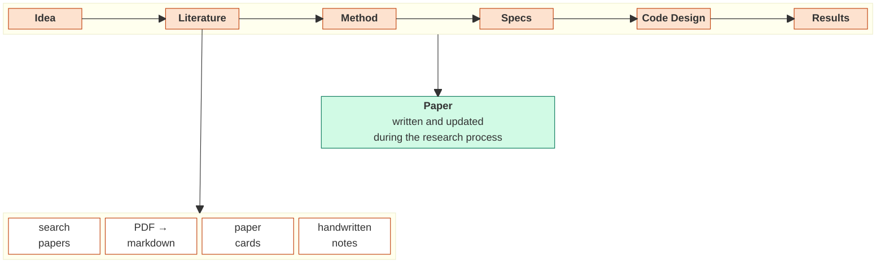

**A template for AI research projects. One command creates the project folder; Claude Code
works in it with you, following rules written in the folder.**

Reading, idea, specs, experiments, results and the LaTeX paper each get their own folder,
and each folder has a `CLAUDE.md` saying what the agent may write there. You work in
Obsidian; the agent works next to you.

## How a project flows



## What you get

| | |
| --- | --- |
| **Literature** | `/lit-search` proposes papers for your idea, each one found and opened online. You pick; `/lit-download` and `/lit-convert` bring the PDF, the BibTeX and a markdown version the agent can read, converted locally and offline. |
| **Cards** | One card per paper, shaped by the focus you give, and syntheses when you ask for them. |
| **Idea vs. implementation** | Your claims in `2_Idea/`, concrete choices in `3_Implementation/`. Files are free: a few headings, no forms. |
| **Experiments** | Each has a stable id (`E01`…). A mermaid tree shows what depends on what. |
| **Results** | Every number names the log or run it comes from. Nothing invented. |
| **Paper** | `5_Paper/` is self-contained LaTeX for Overleaf, citing with the library's keys. |
| **Code** | `MYPROJ/` is a standalone uv project you can publish on its own. |
| **Continuity** | A short briefing read at the start of each session, and a journal of what was tried and why. `/wrap` updates both. |

## Quick start

```sh
git clone https://github.com/LeonardoSani/OmniFrame.git ~/Projects/OmniFrame
~/Projects/OmniFrame/bin/omniframe link     # puts `omniframe` on your PATH
uv tool install marker-pdf                  # the PDF converter. Large: pulls torch
brew install llama.cpp                      # its local backend (Apple Silicon / CPU)

cd ~/Projects
omniframe init MYPROJ                       # → MYPROJ_Brain/, code in MYPROJ_Brain/MYPROJ/
```

Open `MYPROJ_Brain/` in Obsidian and in Claude Code, and write `2_Idea/High_level.md`. On
an NVIDIA GPU, use vLLM as the converter's backend instead.

**→ [The Guide](GUIDE.md)** has the full pipeline, command by command.

<details>
<summary><b>Folder layout</b></summary>

```
MYPROJ_Brain/                one git repo, one Obsidian vault
├── 0-Master.md              the front page
├── CLAUDE.md                the agent's rules
├── 1_Literature/
│   ├── Paper_Index.md       every paper once: arXiv · code · site · pdf · md · card
│   ├── Proposed_literature.md   search results waiting for your decision
│   ├── PDFs/ Papers/ Cards/ Literature_Outputs/
│   └── Human_encoding/      your handwritten notes. The agent reads one only when you ask
├── 2_Idea/
│   ├── High_level.md        the idea in plain words. What /lit-search reads
│   ├── Setup_and_Method.md  notation · problem · method · hypotheses
│   ├── Experiments.md       what each experiment is for, by E-id
│   └── Human_encoding/      your handwritten notes. The agent reads one only when you ask
├── 3_Implementation/
│   ├── Specs.md             the concrete choices for each experiment
│   ├── Figures.md           what each figure must show
│   └── Code_Design.md       where the code goes
├── 4_Results_and_Tracking/
│   ├── Where_we_are.md      the briefing, rewritten by /wrap
│   ├── Journal.md           what was tried, decided, abandoned, and why
│   ├── Results.md           the analysis
│   └── Scenario_Tree.md     the experiment tree
├── 5_Paper/                 LaTeX for Overleaf
└── MYPROJ/                  the code only: the future public repo
```

</details>

## Updating a project

```sh
omniframe update                            # inside a project
```

Brings in new commands and rules. Your content is never touched; files you edited are shown
as a diff first.
