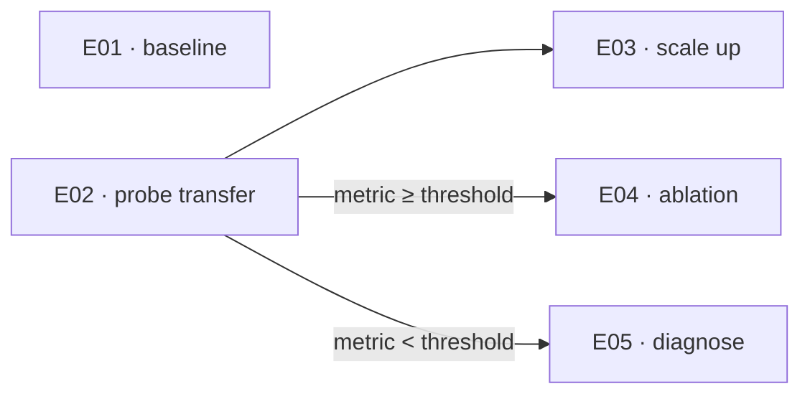

# Scenario tree

The dependency structure between experiments. A DAG rather than a tree: branches
reconverge, and two experiments can share a dependency.

Three relations, each drawn differently. The distinction is the whole point of the file:

- **parallel** — a node with no incoming edge. Several roots means those experiments are
  independent and can run at the same time.
- **unconditional sequencing** — a plain edge, `E02 --> E03`. E03 needs E02 *finished*,
  whatever the outcome: it reuses a checkpoint, an artifact, a trained model.
- **outcome-conditional** — a labelled edge carrying the condition. Diverging labelled
  edges out of one node are a branch point: only one side will happen.

Both edge kinds mean "comes second", but only a labelled edge can make an experiment
never happen. Conflating them either serialises work that could have run in parallel, or
runs an experiment whose premise was already refuted.

Node ids are the E-ids from `2 Idea/Experiments.md`, verbatim — so one grep finds an
experiment's dependencies and its dependents together.

## Runnable now

The experiments whose dependencies are satisfied — the batch that can be launched in
parallel today. Recomputed from the DAG and `Runs/` whenever an outcome lands. A
dependency is satisfied only on the evidence of a run record.

- E01 — no dependencies
- E02 — no dependencies

## Blocked

- E03 — waiting on E02 to finish
- E04, E05 — waiting on E02's outcome
